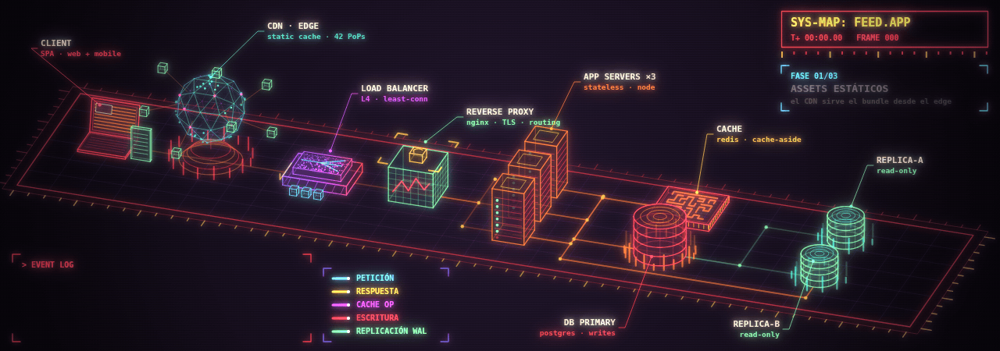
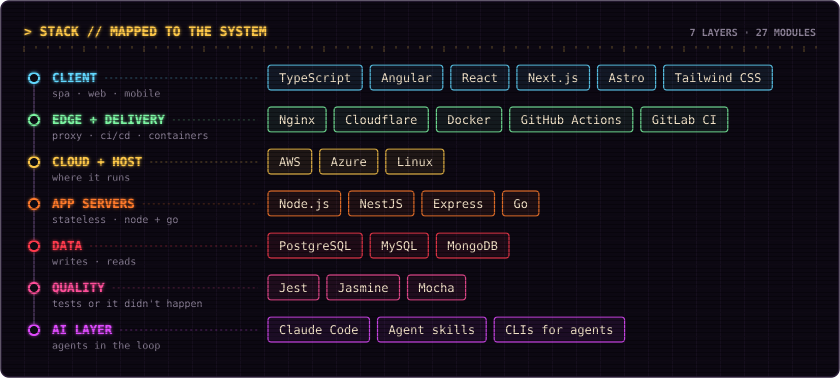

Hi, I'm **Leandro**, Product Builder + Engineering Manager at **Reyesoft**.

I've spent several years writing code, solving problems and building products that stay maintainable as they scale.

Today I lead a fintech product team, help shape the architecture behind it, and build tools so AI agents can take on the repetitive work: code review, QA, tickets. My rule is simple: if something repeats more than twice, I automate it.

